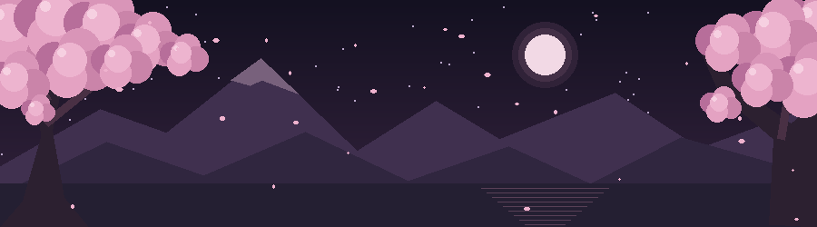
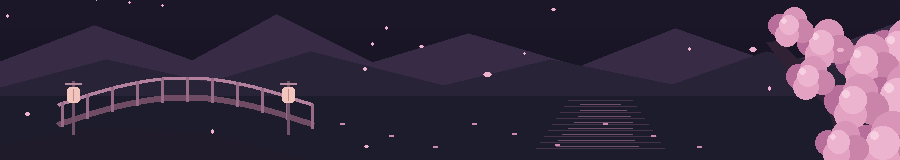

# Konnichiwa, Kian desu (^\_~)

### Web developer from the Philippines

Building thoughtful things for the web, one commit at a time.

## A little about me

I'm a web developer from the Philippines who enjoys turning ideas into useful, well-crafted experiences.

- Working with **TypeScript & React** up front, and **Node.js, Java & C#** behind the scenes.
- Currently building **Daeframe**, a personal website for marketing purposes and portfolio.
- Exploring new tools, game development, and the little details that make a big difference.
- Open to collaborating on thoughtful projects.

 

## My developer toolkit

**Languages**  
TypeScript · JavaScript · Java · C# · Python · PHP · SQL

**Frontend**  
React · Next.js · HTML5 · CSS3 · Tailwind CSS

**Backend & tools**  
Node.js · Laravel · Symfony · MySQL · PostgreSQL · Git

**Also exploring**  
Unity · Godot · Android

## Things I've been building

<table>
<tr>
<td width="33%" valign="top">
<h3>Daeframe</h3>

Showcasing ideas built to stand out.

Our official marketing website featuring our portfolio, past projects, and creative work

<code>ReactJS</code> <code>Vite</code> <code>Supabase</code>
</td>

<td width="33%" valign="top">
<h3>Project Habit</h3>

A disciplined day is a productive day.

A mobile app for building consistent daily routines and tracking habits.

<code>ReactNative</code> <code>TypeScript</code> <code>Expo</code>
</td>

<td width="33%" valign="top">
<h3>BioHome</h3>

Making biology fun, one question at a time.

An interactive mobile quiz game designed to test and improve your science knowledge.

<code>Godot</code> <code>C#</code> <code>.NET</code>
</td>
</tr>
</table>

---

### Let's make something good.

Have an idea, a question, or just want to say hi? I'd love to connect.

<!-- Add your real project and contact links before publishing. -->

Keep learning. Keep building. Bloom at your own pace.

<!-- GitHub controls the page background using the reader's theme.
The sakura banner has its own dark background in every theme. -->
