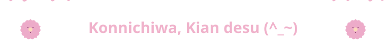

### Web developer from the Philippines

Building thoughtful things for the web, one commit at a time.

 
<h3 align="center">Myself</h3>

I'm a developer who enjoys building things for the web, mobile, and games.

Outside of coding, I'm a musician, gamer, and aspiring Precision Agriculture Specialist. I'm also learning CSG modeling and environment art to bring more creative ideas to life.

 

---

<h3 align="center">My Stats</h3>
 

  <table width="100%" cellpadding="0" cellspacing="0" border="0">
    <tr>
      <!-- Productive Time -->
      <td width="33.33%" align="center">
        
      </td>
      <!-- Streak Stats -->
      <td width="33.33%" align="center">
        
      </td>
      <!-- Most Used Languages -->
      <td width="33.33%" align="center">
        
      </td>
    </tr>
  </table>

 

<h3 align="center">Current Projects</h3>
 

<table>
<tr>
<td width="33%" valign="top">
<h3>Daeframe</h3>

Showcasing ideas built to stand out.

Our official marketing website featuring our portfolio, past projects, and creative work

<code>ReactJS</code> <code>Vite</code> <code>Supabase</code>
</td>

<td width="33%" valign="top">
<h3>Project Habit</h3>

A disciplined day is a productive day.

A mobile app for building consistent daily routines and tracking habits.

<code>ReactNative</code> <code>TypeScript</code> <code>Expo</code>
</td>

<td width="33%" valign="top">
<h3>BioHome</h3>

Making biology fun, one question at a time.

An interactive mobile quiz game designed to test and improve your science knowledge.

<code>Godot</code> <code>C#</code> <code>.NET</code>
</td>
</tr>
</table>

 

   
   
  

---

<i>“Simplicity and elegance are unpopular because they require hard work and discipline to achieve and education to be appreciated.” </i>

<b><i>-Edsger W. Dijkstra</b></i>

